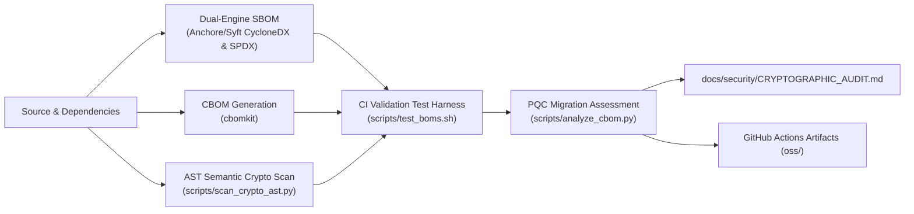

You *may* have to delete the files in the persistence/db/* to get this to work!

(spire2) ➜  spire-server git:(main) ✗ ./run.sh                
==========================================
   🚀 Starting SPIRE HA Demo Automation   
==========================================
Step 1: Running Infrastructure Setup (setup_demo_v9.py)...
--- Generating High-Frequency Renewal Configs in /Users/jsoehner/spire-server/spire_setup ---
--- Preparing Directories ---
Updated: /Users/jsoehner/spire-server/spire_setup/db-init/init.sql
Updated: /Users/jsoehner/spire-server/spire_setup/server1/server.conf
Updated: /Users/jsoehner/spire-server/spire_setup/server2/server.conf
Updated: /Users/jsoehner/spire-server/spire_setup/nginx/nginx.conf
Updated: /Users/jsoehner/spire-server/spire_setup/docker-compose.yaml

--- Launching Infrastructure ---
Stopping any existing containers...
Starting containers (postgres, servers, load-balancer)...
[+] up 5/5
 ✔ Network spire_setup_default            Created                                                                                                                                                                                             0.0s
 ✔ Container spire_setup-postgres-1       Created                                                                                                                                                                                             0.0s
 ✔ Container spire_setup-spire-server-1-1 Created                                                                                                                                                                                             0.0s
 ✔ Container spire_setup-spire-server-2-1 Created                                                                                                                                                                                             0.0s
 ✔ Container spire_setup-load-balancer-1  Created                                                                                                                                                                                             0.0s

✅ Stack launched successfully.
✅ Infrastructure setup complete.
⏳ Waiting 15 seconds for Postgres and SPIRE Server to stabilize...
Step 2: Registering Agent (add_agent-v3.py)...
--- Adding SPIRE Agent to /Users/jsoehner/spire-server/spire_setup ---
Finding SPIRE Server container ID...
Found Server ID: 1a849a52916d57ad8994bc2541fa2ec2b3e7aad11c7dc85bda6afb619c53a4e9
Fetching Trust Bundle...
Saved Trust Bundle to /Users/jsoehner/spire-server/spire_setup/agent/bootstrap.crt
Generating Join Token for spiffe://scotiabank.local/my-first-agent...
Token Generated: 0a8f541e-5bf2-41fb-a231-5f631946b740
Created Agent Config at /Users/jsoehner/spire-server/spire_setup/agent/agent.conf
Appending Agent service to docker-compose.yaml...
Restarting the Agent container...
[+] up 6/6
 ✔ Image ghcr.io/spiffe/spire-agent:1.10.1 Pulled                                                                                                                                                                                             1.6s
 ✔ Container spire_setup-postgres-1        Running                                                                                                                                                                                            0.0s
 ✔ Container spire_setup-spire-server-2-1  Running                                                                                                                                                                                            0.0s
 ✔ Container spire_setup-spire-server-1-1  Running                                                                                                                                                                                            0.0s
 ✔ Container spire_setup-load-balancer-1   Running                                                                                                                                                                                            0.0s
 ✔ Container spire_setup-spire-agent-1     Created                                                                                                                                                                                            0.0s

--- Success! ---
Agent config updated and container restarted.
Check logs: docker compose logs -f spire-agent
✅ Agent registered and started.
==========================================
   🎉 Demo is Running!                    
==========================================
   trust_domain: scotiabank.local
   svid_ttl:     2 minutes (Renew ~1 min)
==========================================
Streaming logs now (Press Ctrl+C to exit)...

To stop the container, change to the spire_setup directory and issue docker compose down.
(spire2) ➜  spire-server git:(main) ✗ cd spire_setup 
(spire2) ➜  spire_setup git:(main) ✗ docker compose down                                                                   
[+] down 6/6
 ✔ Container spire_setup-spire-agent-1    Removed                                                                                                                                                                                             0.1s
 ✔ Container spire_setup-load-balancer-1  Removed                                                                                                                                                                                             0.2s
 ✔ Container spire_setup-spire-server-1-1 Removed                                                                                                                                                                                             0.1s
 ✔ Container spire_setup-spire-server-2-1 Removed                                                                                                                                                                                             0.2s
 ✔ Container spire_setup-postgres-1       Removed                                                                                                                                                                                             0.1s
 ✔ Network spire_setup_default            Removed

---

## 🛡️ Automated SBOM & CBOM Supply Chain Pipeline

This repository features an automated continuous supply chain security pipeline defined in [`.github/workflows/sbom-cbom.yml`](.github/workflows/sbom-cbom.yml). On every push, pull request, or tag release, the workflow executes a multi-stage generation, validation, and auditing process:



### CI Pipeline Stages

1. **Dual-Engine SBOM Generation**: Uses `anchore/sbom-action` to produce standard CycloneDX (`oss/sbom.cyclonedx.json`) and SPDX (`oss/sbom.spdx.json`) inventory files.
2. **Cryptographic Bill of Materials (CBOM)**: Uses `cbomkit/cbomkit-action` to discover cryptographic algorithms, certificates, keys, and cryptographic assets (`oss/cbom.json`).
3. **Dual-Engine AST Semantic Crypto Scan**: Executes `scripts/scan_crypto_ast.py` to parse source code abstract syntax trees (ASTs), mapping cryptographic call-sites and cipher initializations to the CBOM inventory.
4. **Automated Verification Harness**: Runs `scripts/test_boms.sh` to validate JSON schemas, verify required CycloneDX attributes, and enforce non-empty inventory thresholds as a build gate.
5. **Post-Quantum Cryptography (PQC) Assessment**: Runs `scripts/analyze_cbom.py` to classify cryptographic assets by quantum-readiness and output markdown summary dashboards to `$GITHUB_STEP_SUMMARY`.
6. **Continuous Governance Publishing**: Automatically syncs the latest cryptographic posture to [`docs/security/CRYPTOGRAPHIC_AUDIT.md`](docs/security/CRYPTOGRAPHIC_AUDIT.md) and publishes all BOM assets to workflow artifacts.

---

## Local Scripts & Verification

All pipeline stages can be executed locally in development environments using scripts in `scripts/`:

### 1. Generating BOMs (`scripts/generate_boms.sh`)

Generate SBOMs and CBOMs for either source directories or Docker container images:

```bash
# Scan current repository directory (outputs to oss/)
bash scripts/generate_boms.sh -t dir .

# Scan a local Docker image
bash scripts/generate_boms.sh -t docker spire-server:local

# Specify custom output directory and format
bash scripts/generate_boms.sh -t dir -o build/boms -f cyclonedx-json .
```

### 2. Testing & Validating BOMs (`scripts/test_boms.sh`)

Run automated JSON validation, schema verification, and inventory count checks:

```bash
bash scripts/test_boms.sh oss
```

### 3. Scanning Source AST for Crypto Callsites (`scripts/scan_crypto_ast.py`)

Scan Python and repository source code ASTs for cryptographic primitive invocations and reconcile with an existing CBOM:

```bash
python3 scripts/scan_crypto_ast.py . \
  --cbom oss/cbom.json \
  --output-json oss/crypto-callsites.json
```

### 4. PQC Readiness Analysis (`scripts/analyze_cbom.py`)

Analyze a generated CBOM against software dependencies and generate markdown or JSON risk summaries:

```bash
python3 scripts/analyze_cbom.py oss/cbom.json \
  --sbom oss/sbom.cyclonedx.json \
  --json oss/crypto-analysis.json \
  --markdown docs/security/CRYPTOGRAPHIC_AUDIT.md
```

### 5. OCI Artifact Attachment (`scripts/attach_oci_bom.sh` & `scripts/fetch_oci_cbom.py`)

Publish and retrieve CBOMs attached to OCI container registries:

```bash
# Attach CBOM to container image in registry
bash scripts/attach_oci_bom.sh oss/cbom.json my-registry.io/spire-server:v1.0.0

# Fetch CBOM from container image
python3 scripts/fetch_oci_cbom.py my-registry.io/spire-server:v1.0.0 --output-dir oss
```

---

## Architectural Decision Records (ADRs)

Key architectural decisions governing this repository's security, supply chain, and cryptography strategy are documented under [`docs/adr/`](docs/adr/):

- [**ADR-0001: Automated SBOM and CBOM Supply Chain Governance Pipeline**](docs/adr/0001-automated-sbom-cbom-supply-chain-governance.md) - Context, alternatives considered, decision rationale, and downstream consequences for adopting automated dual-engine SBOM/CBOM scanning, AST call-site analysis, and CI gate verification.
